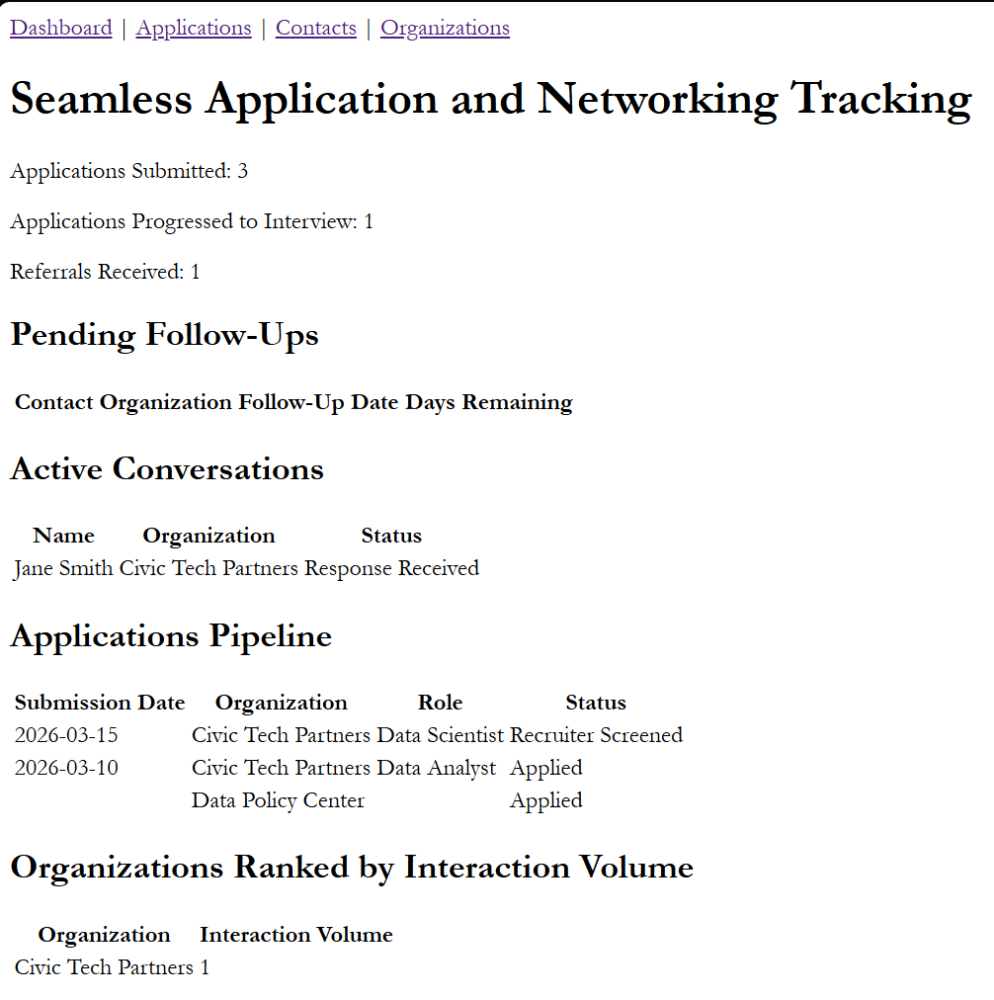
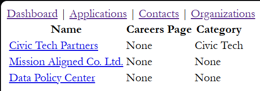
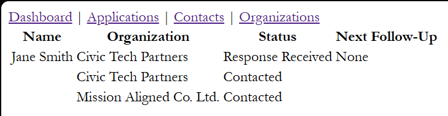
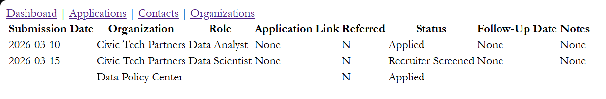

# Job Campaign Tracker

*Deval Mehta | Freelance Data Scientist | Latest as of: April 2026*

**Stack**: Python · Flask · Jinja2 · SQLite · SQL (CTEs, window functions) · python-dotenv

---

## What It Does
A job search generates more data than a spreadsheet is designed to handle well. Job seekers need a more robust system to manage applications, networking interactions, and organizations. The Job Campaign Tracker coordinates information on four tables (`orgs`, `contacts`, `interactions`, and `applications`) to present a dashboard that surfaces follow-ups due, active conversations, and pipeline status, without a user needing to construct a query or scan a spreadsheet.

## Why I Built This
In the midst of a prolonged job search, I became frustrated with my inability to track my applications and see my pipeline's performance data. I hadn't yet started networking, but managing that on top of applications in a spreadshet wasn't going to work. At the same time, my SQL skills had been deteriorating and I needed to polish them. Building this app solved both of those problems simultaneously, and provided a reason to learn more about Flask and Jinja2.

To make sure I was getting the practice I needed, I opted to build in raw SQL, rather than an ORM. I didn't need to hide all the SQL; I needed to work it out for myself.

## Quick Start/Installation
**Requirements**\
Python 3.11.1

**Installation**\
git clone https://github.com/dmehta94/job-campaign-tracker
cd job-campaign-tracker

python -m venv venv
source venv/Scripts/activate  # Windows GitBash
pip install -r requirements.txt

**Configuration**\
Copy `.env.example` to `.env` and populate it with your own values. To generate a secret key:

```python
import secrets
secrets.token_hex(32)
```

**Initialize the Database**
```bash
flask shell
>>> from app.database import init_db
>>> init_db()
>>> exit()
```

**Upgrading an Existing Database (October 2026)**\
If your database was created before October 2026, run this once to move it to the current categories and add the Follow-up interaction type. It writes a backup copy first.
```bash
python scripts/migrate_2026_10.py
```

**Run the App**
```bash
python run.py
```

## Project Structure
job-campaign-tracker/\
├── app/\
│   ├── applications/\
│   │   ├── __init__.py\
│   │   └── routes.py\
│   ├── contacts/\
│   │   ├── __init__.py\
│   │   └── routes.py\
│   ├── dashboard/\
│   │   ├── __init__.py\
│   │   └── routes.py\
│   ├── orgs/\
│   │   ├── __init__.py\
│   │   └── routes.py\
│   ├── templates/\
│   │   ├── applications/\
│   │   │   ├── add.html\
│   │   │   ├── detail.html\
│   │   │   └── index.html\
│   │   ├── contacts/\
│   │   │   ├── add.html\
│   │   │   ├── detail.html\
│   │   │   └── index.html\
│   │   ├── dashboard/\
│   │   │   └── index.html\
│   │   ├── errors/\
│   │   │   ├── 404.html\
│   │   │   └── 500.html\
│   │   ├── orgs/\
│   │   │   ├── add.html\
│   │   │   ├── detail.html\
│   │   │   └── index.html\
│   │   └── base.html\
│   ├── __init__.py\
│   ├── database.py\
│   └── schema.sql\
├── images/\
|   ├── applications.png\
|   ├── contacts.png\
|   ├── dashboard.png\
|   └── orgs.png\
├── scripts/\
│   └── seed.py\
├── tests/\
├── .env.example\
├── .gitignore\
├── config.py\
├── LICENSE\
├── README.md\
├── requirements.txt\
└── run.py

## Sample Output

*Dashboard — follow-ups due, active conversations, and pipeline status*


*Organizations list*


*Contacts list*


*Applications list*

## What I Learned
**Flask \& Web Framework Concepts**\
I came into this project knowing how to construct a small single-script app — nothing close to the scale or organization this project required. The most important concept I learned was the application factory pattern: rather than instantiating the app at the module level, create_app() defers instantiation so configurations can be swapped at runtime. The rest of the app is organized around blueprints — one directory per feature, each containing a routes file and its initialization file. Templates are stored similarly within a templates subdirectory. Shared components like the database module and config living at the app level.

**SQL Depth**\
This project served as a hands-on refresher for CTEs, window functions, and correlated subqueries — techniques in which I'd previously been fluent, but hadn't used in quite some time. CTEs break complex logic into readable steps; window functions annotate rows without collapsing them the way a `GROUP BY` would; correlated subqueries reference values from the outer query row by row. All three are used in the dashboard queries. I also returned to SQLite after a long time away — `get_db()`, `.execute()`, `.fetchone()`/`.fetchall()`, and `.commit()` form the full interface. `sqlite3.Row` objects require bracket notation inside Jinja2 templates; dot notation works in Python but fails silently in template loops.

**Jinja2**\
Jinja2 was entirely new to me coming into this project. At its core, it's a templating language with Python-like syntax that renders server-side before the page is sent to the browser. The practical payoff is not having to write every piece of HTML explicitly — template inheritance lets child templates extend a shared `base.html`, and looping over query results builds tables dynamically rather than hardcoding rows. The `sqlite3.Row` bracket notation requirement noted above is a direct consequence of how Jinja2 renders templates — it's not executing Python, so dot notation fails silently.

**Software Engineering Practices**\
I came into this project intending to work collaboratively with Claude — using it for ideation and structure, then having it guide me through the build. Early on, Claude jumped ahead and produced code before I'd had a chance to work through it myself. I recognized what had happened and reset the dynamic, asking Claude to explain concepts first, ask guided questions, and let me write the code. That decision shaped the entire project.

This is the first project for which I wrote a `pytest` suite. The idea seemed overwhelming at first, as I unfortunately waited until the tail end to write the whole suite. That said, as I worked through the tests, I learned just how simple writing tests with `pytest` is: naming conventions minimize the number of imports, fixtures have an inheritance-like structure regarding dependencies, and Flask's testing configuration automatically handles creating a test client, so all I had to do was wire it into the fixture. I ran into three debugging lessons along the way:

* I had initially written `sqlite:///test.db` as the `DATABASE_URI` for the testing configuration, but that's not the format that SQLite recognizes. Instead of a URI, I needed a file path, so that had to be replaced with `test.db`.
* I'd been familiar with 200 as the status code for successfully loading a page. I assumed that I needed to assert that for all of my tests, but learned that for a redirect after a successful form submission, I needed 302.
* Likewise, I knew about 404 and 500 as error codes, but not 405, which denotes a method not being allowed.

I used Conventional Commits throughout, which forced me to think clearly about what each commit was actually doing before writing the message. Maintaining that discipline motivated me to ask for a Git cheat sheet — something I hadn't thought to produce for myself before.

## Limitations
This is a portfolio and learning project, not a production application. A few limitations worth noting:

* **No authentication** — there are no user accounts or access control. Anyone with access to the URL can read and write data.
* **Local only** — the app runs on your machine. There is no deployment or cloud hosting.
* **SQLite at scale** — SQLite is appropriate for a personal tracker but would need to be replaced with a more robust database for multi-user or high-volume use.
* **Shared seed data for tests** — For the sake of simplicity, the whole testing suite relies on the same seed data. For a more robust, application, tests should be fully independent, with isolated per-test data.

## Future Ideas/Next Steps
The limitations of the project lay out my next steps pretty cleanly:

* Accumulate and incorporate user feedback to write additional queries for the dashboard.
* Cloud-based architecture and deployment to make this project truly production-grade.
* Move from SQLite to PostgreSQL to accommodate higher volumes of data and multi-user functionality.
* The notes fields in all the forms are currently type `<text>`. `<textarea>` would be more appropriate for the UI.

One more step to note to make the app production-grade: styling. The app is admittedly very plain right now. A CSS file with branding and style will make it far more visually appealing.

## Credits
Data modeling, application architecture, and all code written by Deval Mehta. Claude (Anthropic) served as a Socratic guide throughout the build — explaining concepts, asking questions, and letting me write the code. Occasional code snippets were generated for reference and illustration, not as delivered implementations.

## License/Author
MIT License. See `LICENSE` for details.

Contact: github.com/dmehta94